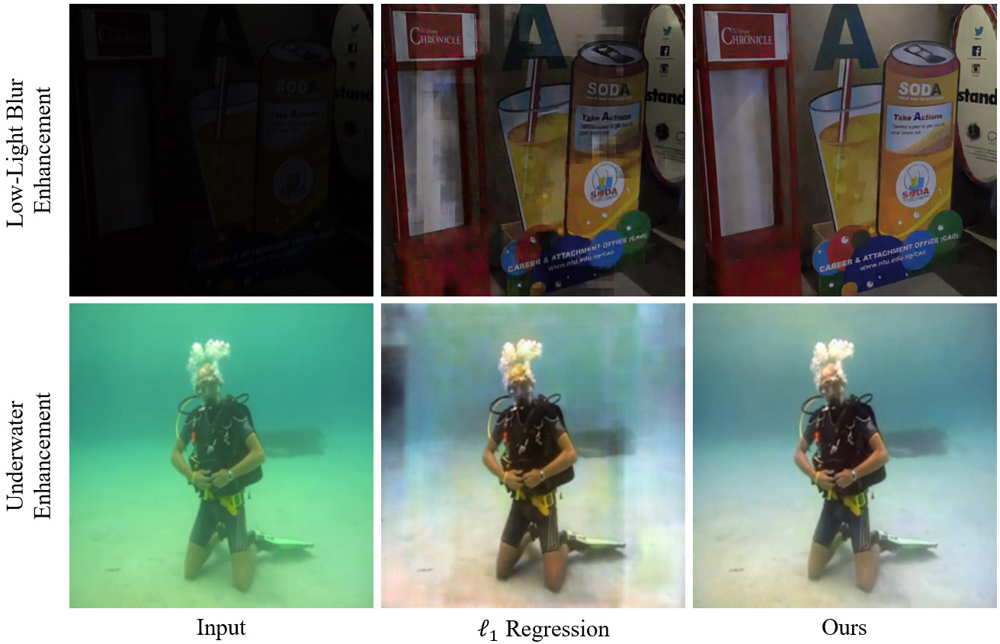

# [Improving Image-to-Image Translation via a Rectified Flow Reformulation](https://iizuka.cs.tsukuba.ac.jp/projects/i2irfr/)

[Satoshi Iizuka](https://iizuka.cs.tsukuba.ac.jp/index_eng.html)\*, [Shun Okamoto](https://minotake-match-life.github.io/index_en.html)\*, and [Kazuhiro Fukui](https://www.cs.tsukuba.ac.jp/~kfukui/english/indexE.html) (\* equal contribution)  
European Conference on Computer Vision (ECCV), 2026

[Paper](https://arxiv.org/abs/2603.20186) | [Project Page](https://iizuka.cs.tsukuba.ac.jp/projects/i2irfr/)

<p align="center">

</p>

## Overview

This repository provides a **minimal PyTorch implementation of Image-to-Image Rectified Flow Reformulation (I2I-RFR)**, proposed in our ECCV 2026 paper.

I2I-RFR converts a conventional image-to-image (I2I) regression network into a continuous-time refinement model with only a few changes to its training and inference procedures. It uses a noisy version of the ground-truth image as an additional input and trains the network to directly predict the clean target with a t-reweighted pixel loss. At inference time, the output is progressively refined using a few explicit Euler steps (3 by default).

The main purpose of this repository is to demonstrate how easily I2I-RFR can be incorporated into existing I2I training code. We use a simplified [Palette](https://iterative-refinement.github.io/palette/)-style U-Net as an example backbone, but the method is not specific to this architecture. In most cases, you can apply I2I-RFR to your own regression network without introducing a diffusion pipeline, explicit time embeddings, or additional trainable modules. Please see the [paper](https://arxiv.org/abs/2603.20186) and [project page](https://iizuka.cs.tsukuba.ac.jp/projects/i2irfr/) for further details and results.

This repository is intended as a minimal reference implementation rather than a complete reproduction of all experimental results reported in the paper.

## Implementation

The repository includes:

- `baseline_network.py`: a simplified U-Net based on the architecture used in Palette.
- `train_baseline.py`: single-GPU training for either I2I-RFR or standard L1 regression.
- `train_baseline_ddp.py`: training with PyTorch DistributedDataParallel (DDP).
- `inference.py`: inference code, including few-step Euler sampling for I2I-RFR.
- `utils.py`: paired-image loading and synchronized data augmentation.

Use `--standard_regression` for ordinary L1 regression. Without this flag, the scripts use I2I-RFR by default.

## Dependencies

- Python 3.10+
- [PyTorch](https://pytorch.org/)  (>= 2.0)
- [torchvision](https://pytorch.org/vision/stable/)
- [Pillow](https://pillow.readthedocs.io/)

A CUDA GPU is recommended for training.

## Dataset

Training uses paired RGB PNG images with matching relative paths in the input and target directories. For example, using the folder structure of the [LOL-Blur](https://github.com/sczhou/LEDNet#lol-blur-dataset) dataset:

```text
datasets/train/
├── low_blur/
│   ├── 0000/0010.png
│   ├── 0000/0011.png
│   └── ...
└── high_sharp_scaled/
    ├── 0000/0010.png
    ├── 0000/0011.png
    └── ...
```

The two directories may be specified independently with `--input_root` and `--gt_root`. Any paired RGB PNG dataset with matching relative paths and image dimensions can be used. The loader applies random cropping, horizontal/vertical flips, and random transposition jointly to each input/target pair.

Datasets are **not** included in this repository. Please obtain them from their original sources.

## Training

**I2I-RFR (default):**

```bash
python train_baseline.py \
    --input_root datasets/train/low_blur \
    --gt_root datasets/train/high_sharp_scaled \
    --save_dir checkpoints/rfr
```

**Standard L1 regression:**

```bash
python train_baseline.py \
    --input_root datasets/train/low_blur \
    --gt_root datasets/train/high_sharp_scaled \
    --standard_regression \
    --save_dir checkpoints/regression
```

**Multiple GPUs (example with two GPUs):**

```bash
torchrun --standalone --nproc_per_node=2 train_baseline_ddp.py \
    --input_root datasets/train/low_blur \
    --gt_root datasets/train/high_sharp_scaled \
    --save_dir checkpoints/rfr_ddp
```

For DDP, `--batch_size` specifies the batch size per GPU. Checkpoints are saved as `latest.pth` in the specified directory. You can resume with `--resume PATH_TO_CHECKPOINT`.

## Inference

Run I2I-RFR inference on one image or a directory:

```bash
python inference.py \
    --input datasets/test/low_blur \
    --output results/rfr \
    --checkpoint checkpoints/rfr/latest.pth \
    --n_sampling_steps 3
```

For a standard regression checkpoint, add `--standard_regression` and use the corresponding checkpoint:

```bash
python inference.py \
    --input datasets/test/low_blur \
    --output results/regression \
    --checkpoint checkpoints/regression/latest.pth \
    --standard_regression
```

The inference script saves both the input (`*_in.png`) and the predicted output (`*_out.png`), preserving the subdirectory structure when processing a folder. The output has the same spatial resolution as the input.

## Applying I2I-RFR to Your Own Model

I2I-RFR is intended as a lightweight modification of conventional supervised I2I training. For an image-to-image network, **(1) expand the input channels to concatenate the input image with an intermediate target state (e.g., from 3 to 6 channels for RGB-to-RGB)**, then replace the usual L1 training step with **(2) constructing the intermediate state by mixing the ground-truth target with Gaussian noise** and **(3) using a t-reweighted L1 loss**. The following examples compare standard L1 regression with I2I-RFR:

```python
# Standard L1 Regression:
loss = (model(input) - gt).abs().mean()
```
```python
# I2I-RFR:
t = torch.rand(gt.size(0), 1, 1, 1, device=gt.device).sqrt().clamp_min(1e-3)
noise = torch.randn_like(gt)
y_t = (1 - t) * gt + t * noise
loss = ((model(torch.cat((input, y_t), dim=1)) - gt).abs() / t).mean()
```

At inference time, initialize `y_t` with Gaussian noise and perform a few explicit Euler steps to progressively refine the output.

```python
with torch.inference_mode():
    y_t = torch.randn_like(input)
    for step in range(3):
        t = 1.0 - step / 3
        prediction = model(torch.cat((input, y_t), dim=1))
        velocity = (y_t - prediction) / t
        y_t = y_t - velocity / 3
    output = y_t
```

## License

This repository is released under the [MIT License](LICENSE).

## Citation

If you find this code or I2I-RFR useful in your research, please cite:

```bibtex
@inproceedings{iizuka2026i2irfr,
  author    = {Satoshi Iizuka and Shun Okamoto and Kazuhiro Fukui},
  title     = {{Improving Image-to-Image Translation via a Rectified Flow Reformulation}},
  booktitle = {European Conference on Computer Vision (ECCV)},
  year      = {2026}
}
```
